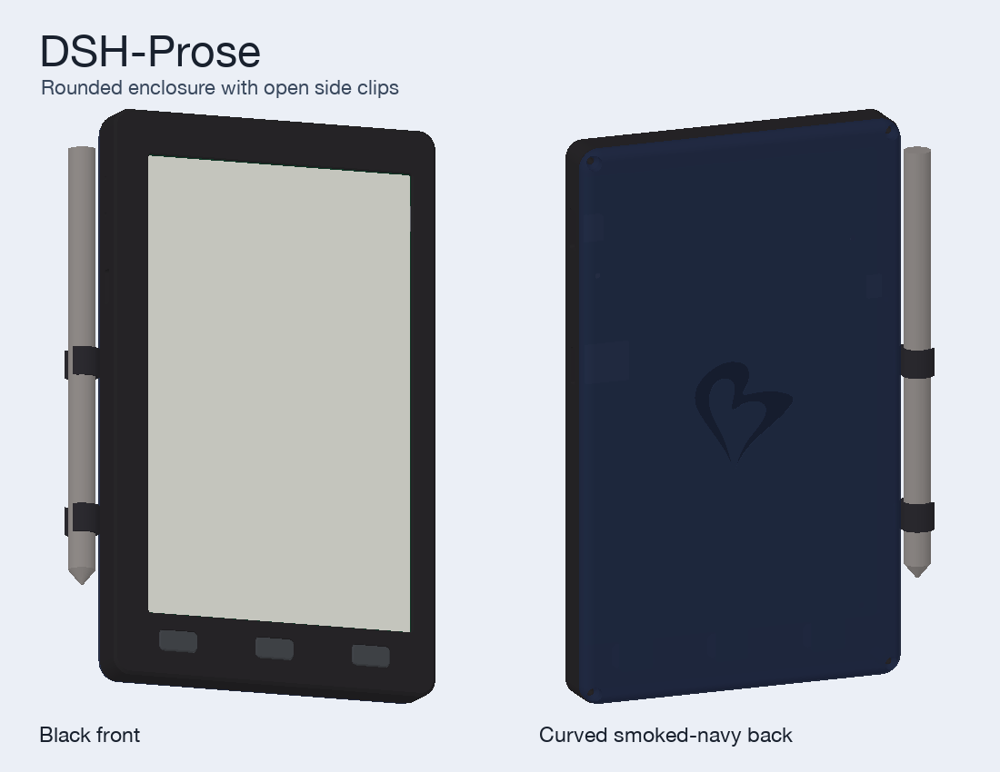
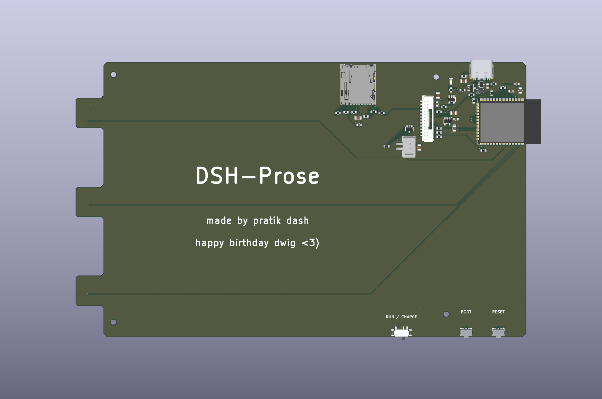
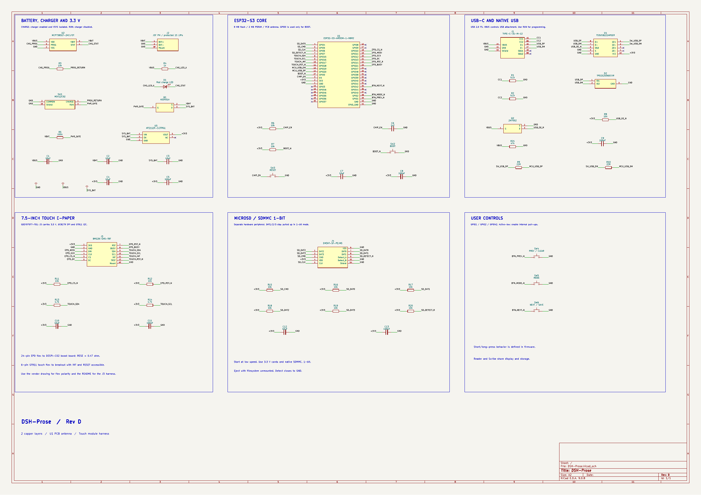

# DSH-Prose

A handheld e-paper reader and sketchpad I designed as a birthday gift for Dwig. I wanted to make something personal that he could actually use to read, take notes, and sketch. It has a 7.5-inch touchscreen, three front buttons, a custom ESP32-S3 board, and a curved case with a clip for a stylus.


## How to use it

1. Format a microSD card as FAT32 and put plain-text books in a folder called `books`. Insert it before powering on.
2. In **Reader**, tap a book and swipe to turn pages. Use the bookmark button to mark your place, or tap a paragraph to attach a handwritten note.
3. In **Scribe**, tap **+** to add a page or **Paper** to change its template. Completed strokes autosave. The **Save** button also exports the ink as a BMP.
4. Tap the sliders icon for Settings. Pick a font, including OpenDyslexic, change text size and line spacing, or switch between light and dark.

The front buttons are **Prev/Clear**, **Mode**, and **Next/Save**. Tap Mode to switch between reading and writing, or hold it to return to the library. The side switch puts the device in **Run** or **Charge**.

## Design screenshots

### Full 3D assembly



[Open-case Fusion view with the populated PCB](assets/DSH-Prose-Fusion-Assembly.png) · [Native Fusion archive](cad/DSH-Prose-Assembly.f3d)

### Rev D PCB



### Schematic

[](hardware/DSH-Prose-Schematic.pdf)

## Project files

| What | Where |
| --- | --- |
| Enclosure and electronics assembly | [Fusion .f3d](cad/DSH-Prose-Assembly.f3d) · [assembly STEP](cad/DSH-Prose-Side-Stylus.step) · [individual STEP and STL parts](cad/) |
| PCB sources | [KiCad project](hardware/DSH-Prose.kicad_pro) · [schematic](hardware/DSH-Prose.kicad_sch) · [board](hardware/DSH-Prose.kicad_pcb) · [project view settings](hardware/DSH-Prose.kicad_prl) |
| Fabrication and assembly | [Gerbers and drill files](hardware/gerbers.zip) · [SMT positions](hardware/DSH-Prose-Positions.csv) · [BOM with purchase links](BOM.csv) |
| Wiring and checks | [Power, pinout and display harness](hardware/README.md) · [ERC and DRC reports](hardware/verification/) |
| Firmware | [C++ source](firmware/) · [PlatformIO configuration](platformio.ini) |
| Product imagery | [Blender scene](assets/DSH-Prose-Studio.blend) |

For the enclosure, print one front frame, one back, three keycaps, and two TPU stylus clips. See the [assembly notes](cad/README.md) for fit and hardware details.

## Build the firmware

Install [PlatformIO Core](https://docs.platformio.org/en/latest/core/installation/index.html), then run these from the repository root:

```sh
pio run
pio run -t upload
pio device monitor
```

The board target is the bare ESP32-S3-WROOM-1-N8R2 module. Flash over USB with a battery attached and the switch set to **RUN**. If USB upload can't enter the loader, hold BOOT, tap RESET, release BOOT, then retry.

**Status:** Design submission. The Rev D PCB passes KiCad ERC and DRC, and the firmware builds. The physical prototype, display and touch bring-up, battery and harness fit, and power-loss testing are still pending. The images above come from the CAD and KiCad files.
