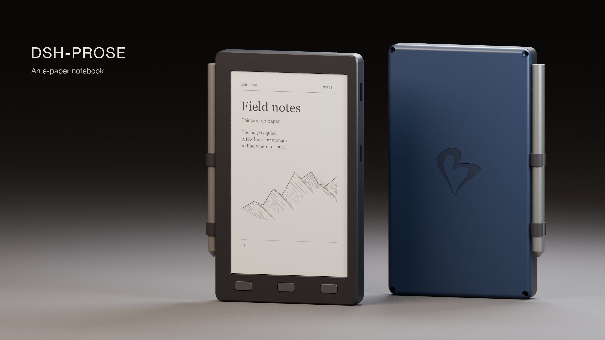

# DSH-Prose

A pocket e-paper reader and notebook. Read plain-text books, sketch on separate notebook pages, and attach handwritten notes to book passages. The firmware is C++ for the DSH-Prose Rev D board and its 7.5-inch Good Display GDEY075T7-T01 touchscreen.



[KiCad project](hardware/) · [Printable enclosure](cad/) · [Assembly view](assets/DSH-Prose-Assembly.png) · [Blender scene](assets/DSH-Prose-Studio.blend)

## Build for Rev D

Install [PlatformIO Core](https://docs.platformio.org/en/latest/core/installation/index.html), then run these commands from the repository root.

```sh
pio run
pio run -t upload
pio device monitor
```

The board definition targets the bare ESP32-S3-WROOM-1-N8R2 module with 8 MB flash and 2 MB quad-SPI PSRAM. Rev D needs a battery and the power switch in **RUN** to flash over USB. If USB upload cannot enter the loader, hold BOOT, tap RESET, release BOOT, then retry. The serial log reports the display system's start, PSRAM, touch and SD status.

## Use it

- Insert a FAT32 microSD card with plain-text books in `/books` before powering on. The first firmware build indexes up to 32 files and reads up to 256 KiB per book. Its built-in fonts cover printable ASCII.
- Open a book from the touchscreen Library. Swipe to turn pages, mark a reading position, or tap a paragraph to open a handwritten margin note. Adjust the font, text size, line spacing and theme in Settings.
- Open a notebook and use the front buttons or touch controls. Tap **+** to add a page, **Paper** to pick a template, and the page name to rename it. Ink autosaves after completed strokes. **Save** also exports the page's ink to a 1-bit BMP in `/notes`.
- The firmware stores reading positions and settings in ESP32 NVS. It keeps two checksummed SD snapshots per notebook page or margin note so a damaged newest snapshot can fall back to the previous one.

## Code

- `firmware/src/` is the Rev D firmware and hardware integration.
- `firmware/ui/` is the shared C++ interface and branding.
- `boards/` and `platformio.ini` describe the toolchain target and dependencies.

The current build has compiled and linked for Rev D. Display refresh, touch orientation and palm-filter behavior, SD saves under real power loss, and the battery-powered USB path still need bench validation. Rev D has no battery-sense connection. Bluetooth pen support is pending.
